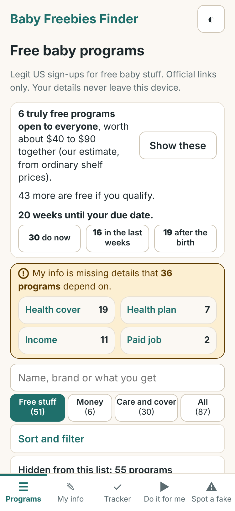
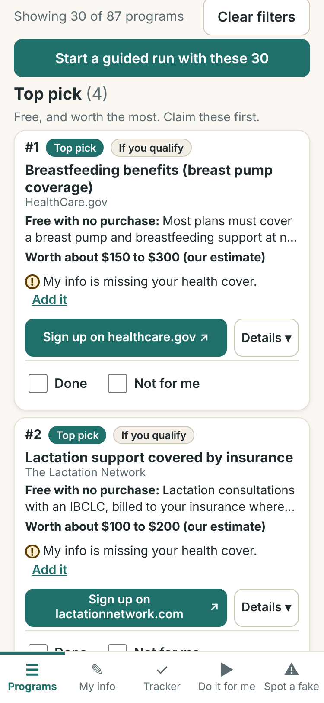
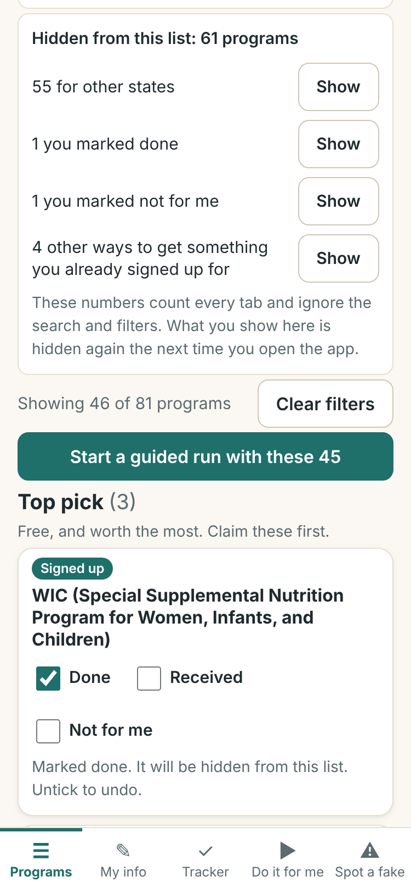
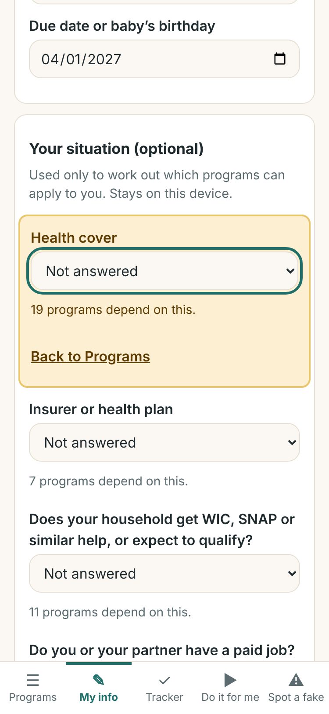
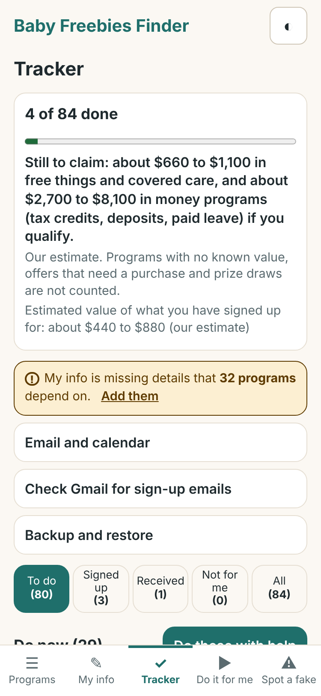
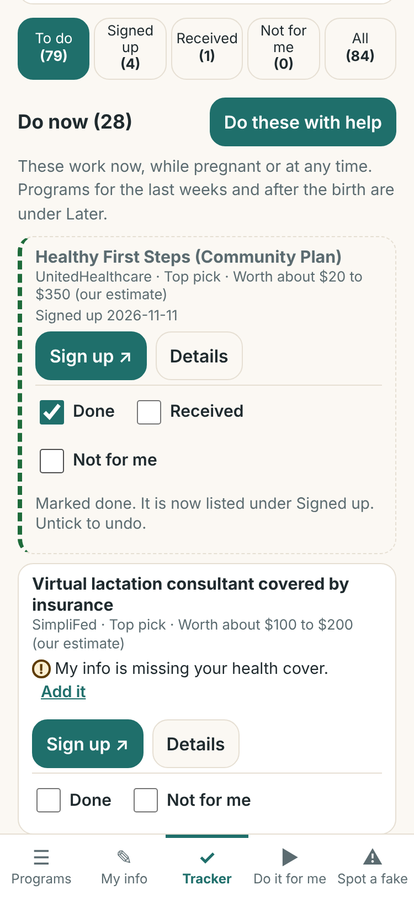
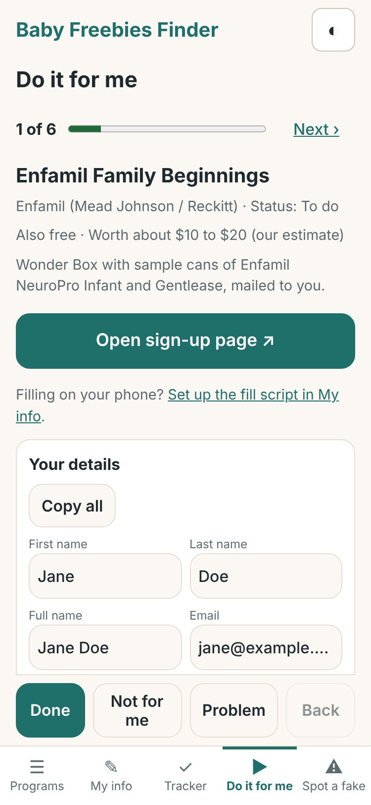
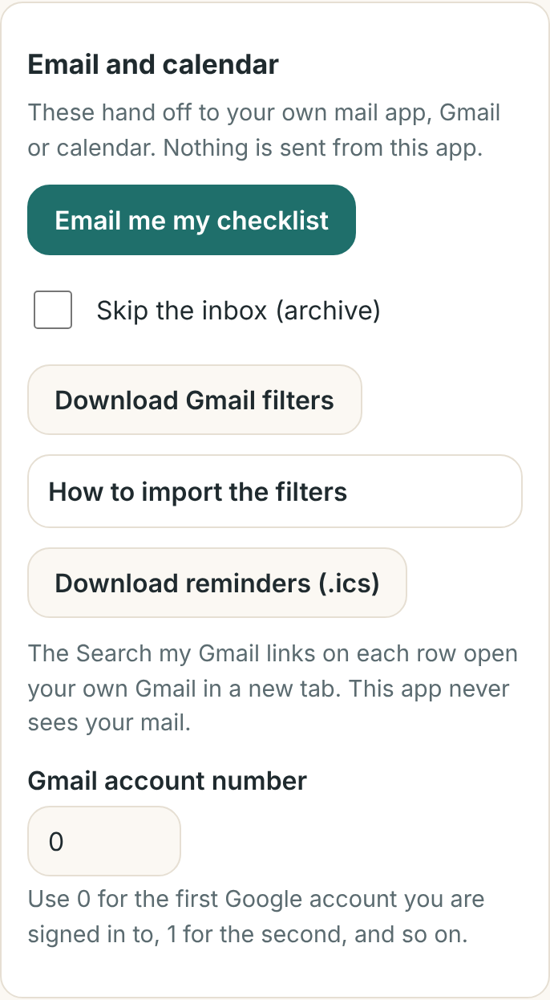
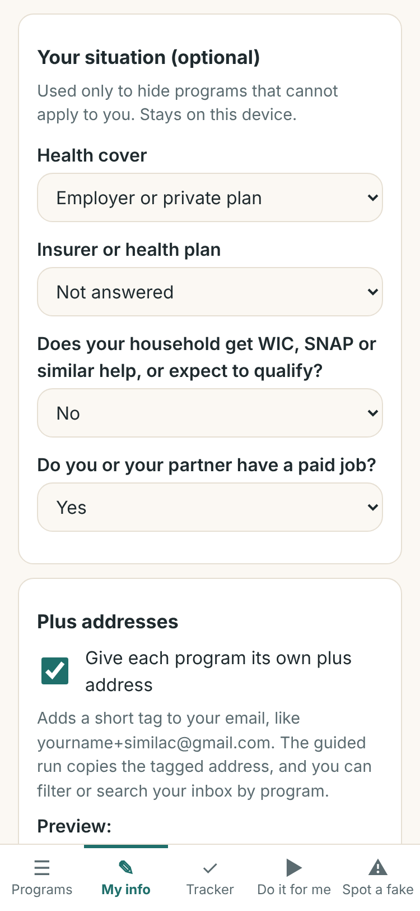
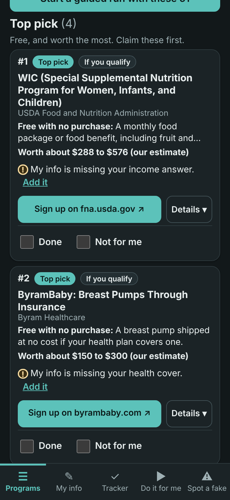

# Baby Freebies Finder

Baby Freebies Finder is a page you can use on a phone or computer to find legitimate US programs for someone expecting a baby. It lists programs that offer free formula, diapers, samples, registry welcome boxes, rewards, health benefits, assistance, and money such as tax credits and savings-account deposits. It ranks them by what is really free and worth the most, and it includes a helper that gets you through the sign-up forms faster. Every link goes to an official program page. The page never submits anything for you, has no ads or trackers, and works offline. It is not affiliated with any brand. Offers change, so always read the official page before you sign up.

## Screenshots

<p align="center">
  
  
  
  
  
  
  
  
  
  
</p>

## What's inside

- **Programs:** the full directory, ranked by what it is worth. The page opens on the **Free stuff** tab. Other tabs are **Money**, **Care and cover** and **All**. A summary shows how many truly free programs are open to everyone, about what they are worth together, and how many more are free if you qualify. Use **Show these** to see just the truly free ones. Search sits above the tabs. Under **Sort and filter** you can sort, filter by "What you get" or category, and tick "Truly free", "Open to everyone", "Email only", "Needs a registry" or "Fits my answers". Each card is short: it shows what arrives free, the estimated value, a badge for how sure it is, and the sign-up link. Press **Details** for the rest, such as the effort, the best time, the catches and the sources. Each card also has tick boxes: **Done** and **Not for me**, plus **Received** once a program is done, for when it arrives. Tick one and the card folds down to its name, the tick boxes and a short note that says what happened and how to undo it, and the program is hidden the next time the list is drawn. Unticking a box you just ticked puts the program back exactly as it was. A **Hidden from this list** box under the filters says how many programs are hidden and why: programs for other states, ones your answers in My info rule out, ones you marked done, ones you marked not for me, and other ways to get something you already signed up for. Each line has a **Show** button, and what you show is hidden again the next time you open the app. The numbers in the box count every tab and ignore the search and filters. If a search or filter matches only hidden programs, the page says how many and why. When a program depends on your state, health plan, income or job and My info does not have that answer yet, a box under the summary says which answers are missing and how many programs depend on each, and each such card says what is missing with an **Add it** link that opens My info at that field. See [How the ranking works](#how-the-ranking-works).
- **My info:** your name, email, address, state and due date. It is stored only in your browser. If the browser stops saving (its storage is full or blocked), a notice appears at the top of every page, and your newest changes then last only until you close the page. Your state hides programs that are only for other states, and your due date builds the plan by due date. **Your situation (optional)** asks four quick questions: health cover, insurer, whether your household gets WIC, SNAP or similar help, and whether you or your partner have a paid job. Programs that cannot apply to your answers are hidden, and ones that fit get a badge. Each unanswered question says how many programs still to do depend on it. When you arrive from an **Add it** link, that field is highlighted and a link takes you straight back to the page you left. Your answers stay in your browser and are never used to fill in forms. Tip: use a dedicated inbox or a plus address like `yourname+baby@gmail.com`, so sign-up mail is easy to filter. At the end of My info, the **Fill forms on your phone** section (tap it to open) shows three ways to fill sign-up forms on an iPhone. See [On an iPhone](#on-an-iphone).
- **Tracker:** your own to-do list. It leaves out programs for other states, ones your answers in My info rule out, and other ways to get something you already signed up for, and it says how many it left out (one button shows them all until you close the page). The top shows how many are done and about how much is still to claim. Tabs split the list into **To do**, **Signed up**, **Received**, **Not for me** and **All**. To do is split into **Do now**, **Later**, and a closed section for offers that need a purchase and long shots. **Do these with help** sends the Do now list to Do it for me. Each row is short: tick **Done** when you have signed up (a **Received** box then appears for when it arrives) or **Not for me** to set it aside, or press **Details** for what you get, the address to sign up with and your notes. A ticked row stays where it is until the list is next drawn, with a note saying where it is listed now. Unticking a box you just ticked puts the row back exactly as it was, with its sign-up date. A to-do row also says which My info answer it is waiting for. **Email and calendar**, **Check Gmail for sign-up emails** and **Backup and restore** are closed sections under the summary; tap one to open it. You can download a JSON backup and restore it later. Inside Claude, checking Gmail is optional. See [Connect Gmail (inside Claude)](#connect-gmail-inside-claude).
- **Do it for me:** pick the programs you want, then go through them one at a time in ranked order. The list has one row per offer, with other ways to get the same thing folded under it, and offers that need a purchase and long shots in a closed section at the end. By default it ticks the truly free programs that are open to everyone, one per offer, and none where you already signed up. The list leaves out what the Programs page hides (programs for other states, ones your answers rule out, ones you marked done or not for me, and other ways to get something you already signed up for), and a line under it says how many were left out. A row says which My info answer it is waiting for. Each step opens the official sign-up page and gives you Copy buttons for your details. You press the buttons yourself. For each program you press **Done**, **Not for me** or **Problem**.
- **Spot a fake:** short tips for telling real freebie offers from scams.

### What's in the directory (142 programs)

| Category | Programs |
|---|---|
| Formula | 6 |
| Diapers & wipes | 7 |
| Registry welcome boxes | 15 |
| Feeding gear | 3 |
| Baby care | 6 |
| Rewards | 1 |
| Health benefits | 39 |
| Assistance programs | 16 |
| Money and savings | 42 |
| Product testing | 7 |
| **All categories** | **142** |

Money and savings covers tax credits, account deposits for newborns and paid family leave. Many programs are limited to some states: 60 of the 142 are.

## How the ranking works

- **Truly free** means free to claim, no purchase or paid membership, a real product or sample comes first, and it does not depend on chance. Sweepstakes, coupons, points and product testing never count as truly free. The "Truly free" tick box, under Sort and filter, shows only these.
- **Open to everyone** leaves out programs that depend on eligibility rules, such as income, insurance or where you live.
- **Five groups**, in this order under "Best value first":
  - **Top pick:** an expected value of 100 dollars or more.
  - **Worth doing:** an expected value of 20 dollars or more, or free health coverage with no known value.
  - **Also free:** the other free programs, including those with an unknown value.
  - **Only if you would buy anyway:** needs a purchase or a paid membership, or its first offer is a coupon or reward points.
  - **Long shot:** a prize draw, product testing, or anything that depends on chance.
- **Expected value** is the middle of the value range times a weight for how sure the offer is: 1 for guaranteed and for "only if you qualify", 0.7 for likely, and 0.1 for a chance.
- **Values are estimates.** Unless the official page gives a figure, a value is our estimate of what one family gets in the first year, and the app labels it that way. For coupons and points, only the saving on things you would buy anyway counts. Pregnancy coverage has no dollar figure, because no fair single figure exists.
- **Where the value sits.** Most of the estimated dollar value is in money programs, and 30 of the 42 money programs pay only if you qualify. Many benefits and insurance-covered items have no dollar figure at all.
- **Guaranteed samples are few.** In the current data, no truly free program is marked guaranteed. Only nine truly free programs have no eligibility rules: six are nationwide and three are for a single state. All nine are marked likely, which means supplies can vary.
- **Where you live.** Programs that are only for some states are hidden until you add your state in My info. After that, the ones for other states stay hidden. The **Hidden from this list** box on the Programs page has a **Show** button for them, and they are hidden again the next time you open the app.
- **Plan by due date.** With a due date in My info, the summary shows the weeks left and buttons that jump to what to do now, to what to do in the last weeks, and to what to do after the birth. Without a due date, it asks you to add one.
- **Same thing, counted once.** When two entries are two doors to the same benefit, the card shows the main one, and the others sit under "N more ways to get the same thing". The totals count that benefit once.
- **Confidence.** The programs added in the latest research are rated medium or low, because their official pages could not be read directly that time. Read the official page before you sign up.

## Automation: buttons and email

These buttons save typing and inbox clutter. Each one either hands off to your own mail app, your Gmail, your calendar or your browser, or downloads a file to your device. **Nothing here submits sign-up forms for you or gets past CAPTCHAs; you press Submit yourself.**

The email features (plus addresses, Gmail filters, Gmail searches and the Gmail connection) cover only programs where signing up means brand mail arrives: programs that need an email and whose sign-up site is not a government site.

- **Plus addresses, for brand sign-ups.** In My info, turn on "Give each program its own plus address". Each covered program gets an address like `jane+similac@gmail.com`, built from your own email. Government and benefit programs keep your plain address. Mail still arrives in your normal inbox, but you can see which program shared your address and filter out any program that sends too much. Yahoo does not support plus addresses, so the app leaves Yahoo addresses plain. For other providers, send yourself a test message first.
- **Gmail filters.** In the Tracker, open **Email and calendar** and press **Download Gmail filters**. Then in Gmail, go to **Settings > See all settings > Filters and Blocked Addresses > Import filters**, choose the downloaded file, tick the filters you want and press **Create filters**. Each filter adds a label such as `Baby Freebies/Program name`. With plus addresses on, the filters match each tagged address exactly, which makes **Skip the inbox (archive)** safe to use. Without them, filters match each program's sender domain and never archive anything.
- **Search my Gmail.** If your email is Gmail, each covered program in the Tracker has a **Search my Gmail** link under its **Details**. It opens your own Gmail in a new tab with a search for that program. If you use a different Google account, in the Tracker open **Email and calendar** and set its number under **Gmail account number**.
- **Email me my checklist.** Opens your mail app with a draft to your own address. The draft lists each program with its status and sign-up link. You can edit it; the app sends nothing. If the list is too long for an email link, it is cut short there and the full text is copied for you to paste.
- **Calendar reminders.** Press **Download reminders (.ics)** to get a calendar file with one all-day reminder for each program marked Signed up, 28 days after you marked it. Open the file to add the reminders to your calendar.
- **Guided run.** "When I tap Done or Not for me, open the next sign-up page" is on by default, so the next program's page opens in a new tab. If your browser blocks the new tab, the page tells you to use the Open button. Single-key shortcuts (O, C, D, S, P, B, N) are optional: tick "Enable single-key shortcuts" under **Shortcuts** to turn them on. After Done or Not for me, **Undo** puts that program back the way it was, until you take another action.
- **Start a guided run with these N.** In Programs, after you filter the list, press this button to start a guided run with just the programs shown. If a run is already in progress, the app asks before it replaces that run.
- **Autofill helper.** The optional helper on your computer can work from a backup you download from the Tracker. It writes your statuses into a new `-updated.json` file, which you restore in the Tracker. See [tools/autofill/README.md](tools/autofill/README.md).

## On an iPhone

Three short options, from the least effort to the most. Each one fills empty boxes from My info. You check everything and press the final button yourself.

1. **Safari AutoFill:** no script at all. In Settings, turn on **Use Contact Info** and choose your own contact card.
2. **A Shortcut:** copy the fill script from My info, then run it from Safari's Share menu on an official sign-up page.
3. **A bookmark:** copy the bookmark code from My info and paste it as the address of a Safari bookmark.

The steps, the Home Screen note and the troubleshooting list are in [docs/iphone.md](docs/iphone.md). None of this has been tried on a real iPhone yet.

## Connect Gmail (inside Claude)

This is optional. It works only when the app is opened as a Claude artifact (`artifact.html`) with your Gmail connected in Claude. Nothing happens until you tap a button.

In the Tracker, open **Check Gmail for sign-up emails**. After a tap, the **Gmail connection** card can:

- **Check my Gmail:** search your mail for sign-up and shipping emails from the programs where the email features apply, then list what it finds. Suggested tracker updates change only when you tap them.
- **Label these in Gmail:** add one label, "Baby Freebies", to the conversations it found. It asks you to confirm first.
- **Draft my checklist** and **Draft my setup kit:** save a draft addressed to your own email address. Nothing is sent.

It never sends, deletes, trashes or archives mail, and it never opens or changes anything without a tap. Claude asks you to allow the connector first, and you can decline. Results disappear when you leave the page.

The card can also offer **Use** followed by your Gmail address and "as my email". That copies the address into My info, but only when you tap it.

**Availability:** Anthropic's help pages say that artifacts using connected apps are available on Pro, Max, Ultra, Team and Enterprise plans on Claude on web and desktop, and that connector tools needing approval for each action are not available to artifacts. The help pages do not say whether this works in the Claude iPhone app. If the Connect button does nothing or says the connection is not available, everything else still works; use the Search my Gmail links instead. Labels and drafts may not be offered in every setup, and the card hides any button that is not offered.

Connecting Gmail in Claude, step by step, is on the card itself. The privacy details are in [PRIVACY.md](PRIVACY.md#gmail-connection-inside-claude-only).

## Use it

- **Easiest:** download this repository, then double-click `index.html` to open it in any browser. You can also download just that one file.
- **Online:** use the GitHub Pages link once it is set up (see below). It serves `index.html`.
- **In Claude:** paste the contents of `artifact.html` into a Claude artifact. It is the same app, packaged for Claude. The Gmail connection works only there.

The build writes both files: `index.html` for the standalone page, and `artifact.html` for Claude.

## Host it free on GitHub Pages

1. Merge the pull request into `main`.
2. In GitHub, go to **Settings > Pages > Build and deployment**. Under **Source**, choose **Deploy from a branch**. Under **Branch**, choose `main` and the folder `/ (root)`. Click **Save**.
3. Wait a minute or two. The site appears at https://luisitin.github.io/Babystuff/

If GitHub shows another branch as the default, switch it to `main` first in **Settings > Branches**.

## Update the program data

1. Edit `data/programs.json`. Each program is one entry with these fields:
   - **id:** a short unique name in lowercase with dashes, such as `enfamil-family-beginnings`.
   - **name** and **brand:** the program name and the company behind it.
   - **category:** one of the ten categories listed above.
   - **whatYouGet:** what the family receives, in plain words.
   - **costToClaim:** free, shipping-fee, purchase-required or membership-required.
   - **costDetail:** the cost in a sentence.
   - **requirements:** a list from email, address, phone, due-date, registry, app, purchase, membership, insurance and eligibility.
   - **eligibility:** who qualifies.
   - **region:** for example, US, or the states it covers.
   - **signupUrl:** the official sign-up page (https, on the brand's own domain).
   - **sourceUrls:** official https pages that back up the entry.
   - **verifiedOn:** the date you checked the page, as YYYY-MM-DD.
   - **confidence:** high, medium or low.
   - **catches:** the fine print, such as marketing email or a shipping fee.
   - **notes:** anything else useful.
   - **offers:** what the program gives, most important first. Only from product, coupons, points, sweepstakes, service, coverage, cash and testing.
   - **certainty:** how sure the first offer is: guaranteed, likely, if-eligible or chance.
   - **freeStuff:** what arrives with no cost and no purchase, or an empty string.
   - **valueLow** and **valueHigh:** a rough dollar value for one family in the first year, or both null.
   - **valueSource:** official, estimate or none. Use official only when the official page gives the figure.
   - **valueBasis:** how the value was reached, in a few words.
   - **effort:** quick, some or involved.
   - **when:** pregnancy, late-pregnancy, after-birth or anytime.
   - **whenNote:** the official reason for the timing, or an empty string.
   - **states:** US state codes when the program is only for some states, or an empty list when it is nationwide.
   - **sameAs:** the id of the main program when this entry is only another way to get the same thing, or an empty string.
2. Follow these rules:
   - Use official pages only. Blog roundups and coupon sites are leads, not proof.
   - Record only what the official page says today. If a detail is not there, leave it blank and lower the confidence. Do not guess.
   - Set `verifiedOn` and `confidence` honestly.
   - The data tests check the fields, their allowed values and the value rules (`tests/data.test.mjs`).
3. Run `node scripts/build.mjs` to rebuild `index.html` and `artifact.html`, then run `node --test` to check the data and the build.
4. Commit `data/programs.json`, `index.html` and `artifact.html`.

The `research/` folder shows how the current data was gathered. `research/excluded.md` lists what was left out and why, and `research/factcheck.md` records the fact-check. The Phase G research is in `research/phase-g/`.

## Optional: autofill helper

The autofill helper lives in `tools/autofill` and runs on your own computer. It opens one sign-up page at a time in a visible browser and fills the obvious fields from a `profile.json` file on your computer. It never submits a form, never gets past a CAPTCHA, and you check everything and press Submit yourself. See [tools/autofill/README.md](tools/autofill/README.md) for the full details.

Quick start:

```
cd tools/autofill
npm install
npx playwright install chromium
cp profile.example.json profile.json
node autofill.mjs --list
node autofill.mjs enfamil-family-beginnings
```

Edit `profile.json` with your own details before you run it.

## Automatic checks on GitHub

GitHub runs three automatic checks for this repository. You do not need to install anything. The full guide is in [docs/automation.md](docs/automation.md).

- **CI** runs on every push and pull request. It rebuilds `index.html` and `artifact.html`, fails if either committed file is out of date, and runs the tests.
- **Link check** runs every Monday. You can also start it by hand: open the **Actions** tab, choose **Link check**, tap **Run workflow**, then the green **Run workflow** button. It visits each program's sign-up page and each source page, and reports pages that are gone or that redirect to another site. Pages that block automated visits are listed but never fail the check. When a run passes and closes an open link-check issue, its closing comment says how many links answered OK and how many could not be checked. The latest run, on 2026-11-10, checked 309 addresses: 251 answered OK, none was broken, and 58 refused automated visits. The unchecked links, and what to do about them, are in [docs/link-status.md](docs/link-status.md). The checker never pretends to be a person and never retries a site that refuses it.
- **Email:** GitHub emails the repository owner when a `link-check` issue opens or a scheduled run fails. These are GitHub issue and Actions notifications, not messages from the app.

## For developers

- **Layout:**
  - `src/`: the HTML, CSS and JavaScript source.
  - `data/programs.json`: the program data.
  - `scripts/build.mjs`: builds two self-contained files with the data and code inlined: `index.html` (the standalone page) and `artifact.html` (the same app for a Claude artifact).
  - `tests/`: the unit tests, run with `node --test`.
  - `tests/e2e/`: the browser test, run by hand with Playwright. It is not part of CI.
  - `tools/autofill/`: the optional local helper.
  - `research/`: raw research and notes.
  - `docs/`: guides, including [docs/iphone.md](docs/iphone.md) and [docs/link-status.md](docs/link-status.md).
- **Commands:**
  - `npm test` (same as `node --test`) runs the unit tests.
  - `npm run build` (same as `node scripts/build.mjs`) rebuilds `index.html` and `artifact.html`.
  - `node tests/e2e/run.mjs` runs the browser test. It needs Playwright, is not part of CI, and is run on your own computer.
- **No dependencies:** the app has no frameworks and no runtime packages. Only the optional autofill helper and the browser test use Playwright, and the helper has its own `package.json`.
- **Build check:** a test confirms that both committed files, `index.html` and `artifact.html`, match a fresh build, so edit `src/` or the data, then rebuild.
- **More reading:** [ARCHITECTURE.md](ARCHITECTURE.md) (the build contract), [PRIVACY.md](PRIVACY.md) (what is stored and where) and [CLAUDE.md](CLAUDE.md) (working rules and the data schema).
